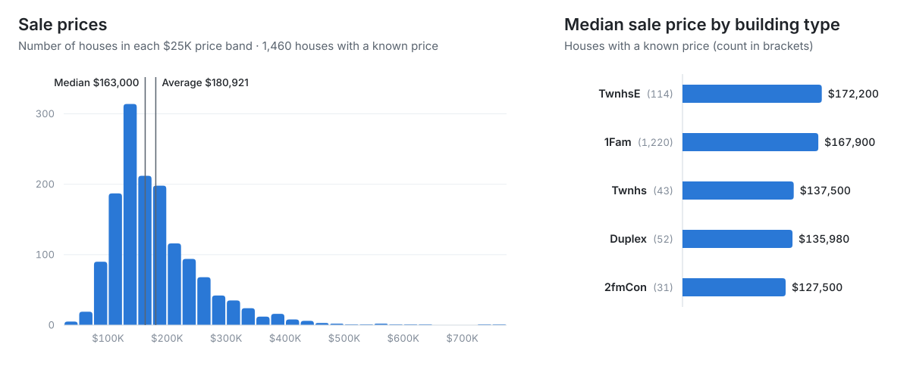
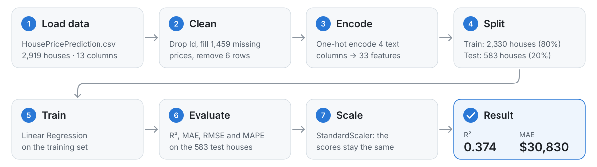
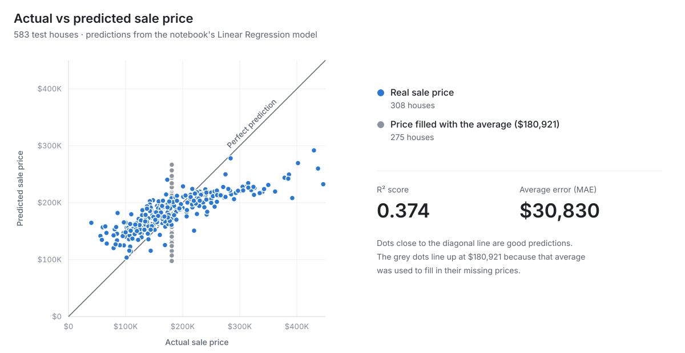

<p align="center">
  
</p>

<p align="center">
  
  
  
  
</p>

Predicting the sale price of a house from its size, location, type and condition using **Linear Regression**. The model is built for HomeVista Properties, a real-estate company that wants to automate how it prices houses. The full problem statement is in [`Supervised_ML.pdf`](Supervised_ML.pdf).

> **Result:** R² = **0.374** · average error (MAE) ≈ **$30,830** · average percentage error (MAPE) ≈ **18.7%**

---

## 📊 Dataset: `HousePricePrediction.csv`

**2,919 houses** and **13 columns**. Each row is one house.

| Column | Meaning | Values in the file |
|---|---|---|
| `Id` | Unique ID of the house | 0 to 2,918 |
| `MSSubClass` | Building class code (e.g. 20 = 1-story, 60 = 2-story) | 16 codes, from 20 to 190 |
| `MSZoning` | Zoning classification of the sale | RL, RM, FV, RH, C (all) |
| `LotArea` | Lot size (sq ft) | 1,300 to 215,245 |
| `LotConfig` | Lot configuration | Inside, Corner, CulDSac, FR2, FR3 |
| `BldgType` | Type of dwelling | 1Fam, TwnhsE, Duplex, Twnhs, 2fmCon |
| `OverallCond` | Overall condition rating | 1 to 9 |
| `YearBuilt` | Year the house was built | 1872 to 2010 |
| `YearRemodAdd` | Year of remodelling or additions | 1950 to 2010 |
| `Exterior1st` | Exterior covering | 15 types, e.g. VinylSd, MetalSd, HdBoard |
| `BsmtFinSF2` | Type 2 finished basement area (sq ft) | 0 to 1,526 |
| `TotalBsmtSF` | Total basement area (sq ft) | 0 to 6,110 |
| `SalePrice` | **Target:** the final sale price ($) | $34,900 to $755,000 |

**Missing values:** `SalePrice` is known for 1,460 houses and missing for the other **1,459**. A few other cells are also empty: `MSZoning` (4), `Exterior1st` (1), `BsmtFinSF2` (1) and `TotalBsmtSF` (1).

<picture>
  <source media="(prefers-color-scheme: dark)" srcset="images/price-overview-dark.svg">
  
</picture>

Most houses with a known price sold for between **$100K and $250K**. A few expensive houses pull the average ($180,921) above the median ($163,000).

---

## 🧠 How it works

All code is from [`house_price_predictor.ipynb`](house_price_predictor.ipynb).

<picture>
  <source media="(prefers-color-scheme: dark)" srcset="images/workflow-dark.svg">
  
</picture>

### 1. Load and explore the data

```python
import pandas as pd

df = pd.read_csv("HousePricePrediction.csv")
```

The notebook then looks at the data with `df.shape`, `df.head()`, `df.info()` and `df.describe()`.

### 2. Clean the data

```python
# Drop Id as it doesn't contribute in price
df.drop(['Id'],
             axis=1,
             inplace=True)

# Replacing SalePrice empty values with their mean values
df['SalePrice'] = df['SalePrice'].fillna(
  df['SalePrice'].mean()) 

# Drop records with null values
df = df.dropna()
```

- `Id` is removed because it's only a label and says nothing about the price.
- The 1,459 missing sale prices are filled with the **average sale price ($180,921)**.
- Rows that still have an empty cell are removed: 6 houses, leaving **2,913**.

### 3. Encode the text columns

```python
cols = ['MSZoning', 'LotConfig', 'BldgType', 'Exterior1st']
df = pd.get_dummies(df, columns=cols, drop_first=True)
```

A regression model needs numbers, so **one-hot encoding** turns each category (for example `BldgType = Duplex`) into its own True/False column. `drop_first=True` drops one category per column because it's already implied when all the others are False. This gives **33 input features**.

### 4. Split into training and test sets

```python
# Train-Test Split
from sklearn.model_selection import train_test_split

X = df.drop(['SalePrice'], axis=1)
Y = df['SalePrice']

X_train, X_test, y_train, y_test = train_test_split(
    X, Y, test_size=0.2, random_state=0)
```

80% of the houses (**2,330**) train the model and 20% (**583**) are kept aside to test it. `random_state=0` makes the split the same on every run.

### 5. Train the Linear Regression model

```python
# Train Linear Regression Model
from sklearn.linear_model import LinearRegression

model = LinearRegression()
model.fit(X_train, y_train)
```

Linear Regression learns one weight per feature. It predicts a price as a starting value (the intercept) plus each feature multiplied by its weight.

### 6. Evaluate the model

```python
# Model Evaluation
from sklearn.metrics import r2_score, mean_absolute_error, mean_squared_error
from sklearn.metrics import mean_absolute_percentage_error
import numpy as np

y_pred = model.predict(X_test)

print("R2 Score:", r2_score(y_test, y_pred))
print("MAE:", mean_absolute_error(y_test, y_pred))
print("RMSE:", np.sqrt(mean_squared_error(y_test, y_pred)))
print(mean_absolute_percentage_error(y_test, y_pred))
```

Results on the 583 test houses:

| Metric | Score | What it means |
|---|---|---|
| **R²** | 0.374 | The model explains about 37% of the variation in sale prices (1.0 would be perfect) |
| **MAE** | $30,830 | Predictions are off by about $30,830 on average |
| **RMSE** | $41,139 | Similar to MAE, but large misses count more |
| **MAPE** | 18.74% | Predictions are off by about 18.7% of the house's price on average |

<picture>
  <source media="(prefers-color-scheme: dark)" srcset="images/actual-vs-predicted-dark.svg">
  
</picture>

Each dot is one test house; the closer it is to the diagonal line, the better the prediction. The 275 grey dots form a vertical line because their missing price was filled with the average ($180,921) in step 2.

### 7. Try feature scaling

```python
# Feature Scaling - to try & improve baseline performance
from sklearn.preprocessing import StandardScaler

scaler = StandardScaler()
X_train_scaled = scaler.fit_transform(X_train)
X_test_scaled = scaler.transform(X_test)

model = LinearRegression()
model.fit(X_train_scaled, y_train)

y_pred = model.predict(X_test_scaled)
```

Each feature is rescaled to mean 0 and standard deviation 1, then the model is trained and evaluated again. The scores come out **exactly the same** (R² 0.374, MAE $30,830). That's expected: scaling changes the size of Linear Regression's weights, but not its predictions.

---

## 🔭 Next steps

As noted at the end of the notebook, the next step to improve results is to try other regression models and ensemble techniques such as **bagging** and **boosting**.

## ▶️ How to run

```bash
git clone https://github.com/Preetbbhalala/House_Price_Predictor.git
cd House_Price_Predictor
pip install pandas numpy scikit-learn jupyter
jupyter notebook house_price_predictor.ipynb
```

Then choose **Run All**.

---

## 👤 Author

**Preet Bhalala**: [@Preetbbhalala](https://github.com/Preetbbhalala)

⭐ If you found this project useful, please give it a star!
